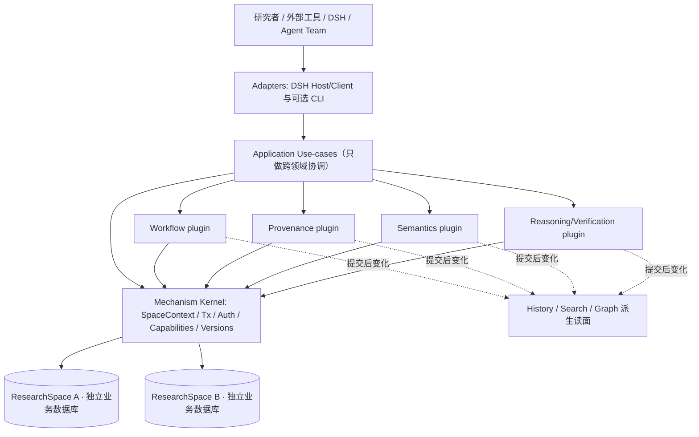

# dsh-research-control V3 — 完整代码架构草案

> **状态：DRAFT-PROPOSAL / 待架构审查，不是冻结实施契约** · 2026-10-27  
> **讨论来源：** 用户逐项裁定 Q1–Q35；与 [H/S/R 三正交系统讨论稿（PR #42）](https://github.com/ArmourPiercer1/dsh-research-control/pull/42) 对照；此前 [V3 实施契约草案 PR #33](V3_IMPLEMENTATION_CONTRACT-DRAFT.md)、[V3 架构基线](ARCHITECTURE_BASELINE.md) 和 PoC 为历史设计输入，而非本方案自动承接的实现命令。  
> **起草基线：** `main@3d5bd184d9d65ae5a2c87155a87678834484218e`。本文仅涉及未来 V3 的代码结构；**不改变当前 V1 冻结契约、生产数据、Host 接线或权限，不批准开发、不解锁任何 LIVE_* 等级，不设实施阶段或排期**。  
> **决策标记：** [已裁定] 为 Q1–Q35 已确认的原则；[工程建议] 是本文提出、需在架构审查时批准的具体结构；[上层待定] 留给 H/S/R 科研语义、形式化与校验体系，不由代码架构代为裁决。

## 1. 目标、边界和反目标

### 1.1 产品定位

[已裁定，Q1/Q2/Q3/Q4] V3 是**一体化科研管理产品**：组织计划、任务、Run、Gate，并记录科研活动、来源、知识对象、论证与认识变化。它有一个**宿主无关**的 TypeScript 领域核心，正式产品必须提供 DSH Adapter，并考虑与独立的 `dsh-agent-team` 集成。

**控制权边界不可突破：**

- **Research Control** 是科研计划、Task、科研 Run/Gate、科研资料、命题/论证/正式接纳记录的状态权威。
- **Agent Team** 是 Team、Member、消息、唤醒、执行权限和 Agent 生命周期的状态权威。
- **DSH Host** 继续拥有其自身的 Session 事实；Research Control 仅通过公共接口引用、读取或接收有来源的事实。
- 研究管理产品不直接调度或唤醒 Agent；Agent 执行成功既不自动完成科研 Gate，也不自动证成科研命题。
- 允许彻底重新设计 V3 API、ID、存储及内部语义；**不承诺 V1 兼容或自动迁移**。旧版留作归档参考，不因本提案即时退役。

### 1.2 成功标准

[已裁定] 在新增科研领域、替换领域校验或升级语义解释时，变更应主要局限于相应插件、公开契约与必要的适配贡献，不要求修改机制内核、其他插件私有实现或一个不断增长的 Host 中心文件。能从权威数据可靠重建派生视图，保留已登记历史与不确定性，并在明确 ResearchSpace 边界内访问数据。

[工程建议] 成功的结构性证明不以文件行数或 package 数量为唯一指标，而以依赖方向、可复用测试世界、跨插件原子性、故障隔离和新增能力的变更面为准。

### 1.3 非目标与反目标

- 不让 Kernel 理解 Assertion、FactStanding、物理模型、形式证明或科学真值；不强行设计上层语义修订/Fork 准入规则。
- 不构造通用 RDF 三元组数据库、完整 SHACL/OWL 引擎、通用 Agent 编排器或微服务网络来替代明确的领域代码。
- 不引入可在生产进程中任意热替换的第三方不可信代码；首版采用经过审查的同进程可信插件。
- 不要求科研文件永久存在、内容哈希一致或可成功重建；不因外部资源缺失而使整个研究服务停止。
- 不用 Git 作为科研计划/工作流/认识状态的权威数据库。
- 不把出站预留端口实现成跨系统任务委派/可靠消息分发平台；不复制 TeamDomain。
- 不把已有 PoC 测试全部通过等同于 H/S/R 科研语义已被正式批准。

## 2. 路线比较与所选架构

| 选项 | 优点 | 不采用的原因或限制 |
|---|---|---|
| 延续 V1，逐层叠加语义与兼容层 | 迁移成本较小 | V1 的固定 Project/Topic/Workstream、Git/SQLite 双真源和 Host 结构与目标不同；会固化历史耦合 |
| **重新实现有限多 package 的模块化单体** | 领域与基础机制可分包约束，单进程、可事务化、DSH 可作为独立 Adapter | **采用**；仍须用机械测试约束跨包依赖，不能仅依赖目录约定 |
| 全局 RDF/对象引擎或全面微服务化 | 表达扩展自由度或进程独立性更强 | 复杂状态不变量、事务、运行治理与成本不匹配；也不能凭图结构保证科学语义正确 |

**[已裁定，Q11–Q20] 目标形态：Mechanism Kernel + Versioned Domain Plugins + Typed Capability Ports + Application Use-cases + Product Profiles + Host Adapters。** 插件可演化，但其历史解释契约不可被静默覆盖。

## 3. 总体逻辑架构



**图示注意：** Kernel 仅提供作用域明确的共享机制，业务用例经其事务/能力注册获取 Domain Ports。箭头不表示领域插件可以直接写任意数据库。不同 ResearchSpace 之间无连接、无跨空间读取或业务事务；同一 Host 可以管理多个隔离数据库。

### 3.1 H/S/R 与物理代码模块的关系

此前的 H（History）、S（Semantics）、R（Reasoning/Argumentation/Verification）是**正交的职责与保证**，不意味着必须分别拥有数据库或必须一一对应三个 npm package。

| 高层职责 | 推荐实现落点 | 不承担 |
|---|---|---|
| H：已登记变化、时间、来源和历史视图 | 事务/版本基础设施 + Provenance/History 领域能力 + 各插件自己的权威事件或版本史 + History Read 投影 | 未记录事实的还原、科学真实性保证 |
| S：身份、术语、World/Scope、陈述精确含义 | Semantics 领域插件、其 Schema 和版本化解释器 | 科学接纳或命题为真的裁决 |
| R：证据、Argument、Assessment、FactStanding、可选验证与形式化 | Reasoning/Verification 领域插件及其可扩展校验能力 | 将结构或证书通过直接当作科学真理 |
| 工作流 | Workflow 领域插件，与 H/S/R 使用类型化引用连接 | Agent 实际编排 |
| 高级读取 | Search、Graph、Association 等派生能力 | 第二个权威知识真源 |

[上层待定] `ResearchFrame`、`ContextProfile`、Assertion 修订/分叉条件、EvidenceStrength、形式化深度、FactStanding 政策等均在领域插件/上层设计中确定；本文**不规定具体语义规则**。

## 4. 源码与 package 边界

[已裁定，Q19/Q29] 采用 **pnpm workspace 内有限多 package**；文件结构仅为**建议的责任分配**，不是已经批准的文件名或 NPM 包名：

```text
packages/
  contracts/              # 空间、身份、错误、引用等最小共享协议
  kernel/                 # SpaceContext、事务、授权机制、能力注册与生命周期
  storage-sqlite/         # 内核的 SQLite 存储驱动（首选实现）
  plugins/
    workflow/             # Project/Plan/Task/科研 Run/Gate
    provenance/           # 科研 Activity/Entity、工件与来源/可用性登记
    semantics/            # 概念、语境、陈述及版本化解释
    reasoning/            # 证据、论证、审查、接纳与可选校验
    history-view/         # 跨域历史查询投影，不存第二份权威历史
    search/               # 跨域索引/查询组织
    graph/                # 可选高级关系图投影与查询
  application/            # 独立跨插件 Use-case 目录，不强制一案一包
adapters/
  dsh/                    # 正式产品必需；Host/Client + 声明式贡献
  cli/                    # 可选独立入口/测试工具
product/
  dsh/                    # DSH 正式装配声明 / Product Profile
tests/
  architecture/           # package exports、依赖图和越界负例
```

**模块结构必须满足：**

1. Kernel 不 import 具体 Domain Plugin，也不 import DSH；具体插件不 import 其他插件的私有实现或私有表。
2. 各插件通过明确的 `/contracts` 或 `/capabilities` 公共入口提供**版本化强类型 Port**。引用其他插件的**公开契约**是合法的，引用 `/internal` 不合法。
3. DSH 特有的 Tool/RPC/UI 贡献写在 `adapters/dsh` 的对应贡献模块中，业务插件不引用 DSH。
4. Use-case 只通过能力接口协调操作，不能成为拥有全部领域规则的超级 Service；新增普通功能不要求修改通用中心装配源码。
5. Package 是构建/依赖边界；Runtime Plugin 是能力注册/激活单位；Use-case 只是跨域应用逻辑。三者不强求一一对应。
6. 不冻结 package 数量；新增 package 需说明不可由现有职责容纳的边界，但不受永久固定数量门槛限制。

**[工程建议]** `contracts` 只包含小型跨域原语，不放全部领域 DTO 形成另一个 God Package。领域协议由其拥有者发布，具体组装由 Product Profile 和依赖清单完成。

## 5. Kernel 的最小职责与禁止越界

| Kernel 提供 | 明确不负责 |
|---|---|
| 全局唯一但只在 SpaceContext 下解析的对象标识生成机制；`ObjectRef`/`RevisionRef` 的通用引用载体 | 判断不同 Assertion Revision 是否语义等价 |
| SpaceRegistry（仅全局最小管理元数据）、`SpaceContext`、可信身份与授权执行器 | 自动跨空间对象共享与科研可信评分 |
| 事务与命名空间存储接口、可恢复提交、Change Journal | 代领域插件决定 Task 或 FactStanding 的状态规则 |
| Capability Registry、版本/依赖解析、Product Profile、插件生命周期/健康报告 | 特定领域业务接线，Agent 调度或科研规划 |
| 插件数据 Schema/解释契约注册、按空间兼容性与显式结构迁移协调 | 把数据结构迁移偷换为科学语义重新裁决 |

### 5.1 ResearchSpace / SpaceContext

[已裁定，Q23/Q24/Q30/Q31/Q32] `ResearchSpace` 是唯一硬性科研数据访问边界：

- 不同 ResearchSpace **不得相互读取、列举内部内容、解析引用、联合查询或进行业务事务**。同空间内 Project/Topic/Workstream 只是组织和筛选标签，**不承担隔离**。
- 每个 ResearchSpace 拥有独立数据库和插件空间状态。全局空间注册表只保存必要的 ID、存储定位和管理状态，不保存科研内容或全局科研索引。
- 任意入口先校验 Principal 与其空间访问资格，随后创建不可跨空间切换的 `SpaceContext`。没有明确上下文就拒绝访问，不允许隐式默认空间。
- 对象 ID 可以在 Host 范围全局唯一，但这**不构成全局可读性**；已知 ID 不能成为跨空间探测对象是否存在的通道。
- 在同一空间内区分访问资格与具体业务写入/接纳权限，不把“所有内容可被本空间授权用户查询”误读为“所有用户可以任意修改”。

**[工程建议的示意接口，未冻结签名]**

```ts
interface VerifiedPrincipal { readonly id: string; readonly issuer: string }
interface SpaceContext {
  readonly space: OpaqueSpaceHandle;       // 不提供随意切换 SpaceID 的 setter
  readonly principal: VerifiedPrincipal; // 入口认证后的身份，不来自业务参数自报
  readonly capabilities: ScopedCapabilities;
  transaction<T>(work: (tx: SpaceTransaction) => T): T;
}
interface ObjectRef { readonly objectId: string; readonly kind: string }
interface RevisionRef extends ObjectRef { readonly revisionId: string }
```

所有公开业务数据操作都必须绑定 SpaceContext；Kernel 验证**在哪个空间操作**，领域插件通过统一授权机制定义**允许执行什么操作**。这是可信同进程代码的正常 API 保证，不宣称能够隔离恶意插件直接调用 `node:fs`。

### 5.2 权限分界

[已裁定，Q4/Q33] DSH Adapter 只把宿主已验证的调用身份映射成 Principal；Kernel 管可信身份与授权执行入口；各 Domain Plugin 声明自身读写、确认和审查操作的权限条件。`actor` 文本或外部 Agent 的自报 ID 不能单独证明有权确认科研结论。被要求验证的授权条件缺失、时间依据不可信、能力不可用时拒绝权威状态变更。

## 6. 插件契约、依赖与装配

[已裁定，Q11–Q20、Q31/Q32] **稳定的是插件交互、持久化/隔离/版本机制，不是预先冻结的一整套科研对象语义**。

**[工程建议] 插件的公开贡献可分为：**

- `PluginManifest`：插件 ID/代码版本、提供的 Capability ID+契约版本、需要的能力、拥有的数据命名空间、存储 Schema 版本以及声明的迁移/解释能力。
- `DomainPorts`：分别暴露只读查询、需要授权的命令与可重放的历史查询；调用者不得直接写本插件私有存储。
- `ProjectionContributions`：可重建的派生读面/索引描述；不拥有第二个科研事实真源。
- `DshContributions`：位于 DSH Adapter 的对应子模块中，声明工具、RPC、页面入口及其所需 Capability，不污染领域核心。

**装配过程的逻辑边界：**

1. Host 载入一个受审查的插件代码版本和 Product Profile，解析 Capability 版本/依赖并拒绝循环依赖或不兼容图。
2. 每个 Space 分别检查启用集、存储 Schema 与解释器兼容性；必要迁移是显式操作，不由普通读取偷偷发起。
3. 在 Space 作用域内激活能力并管理状态、缓存和数据库句柄；失败只影响依赖它的空间能力，不能自动借其他空间实例满足依赖。
4. 正式产品必须包含 DSH Adapter，但不代表核心运行时依赖 DSH；独立离线入口可使用相同核心。
5. 首版仅支持重启生效的代码升级，不承诺同时驻留多个同名插件实现版本，也不承诺进程内代码热替换。

Product Profile **可声明必需插件**，但必需插件并不获得特殊内核权限；需要分别报告 Host 健康、Space 激活健康、Profile 完整性与各 Capability 可用性。

## 7. 持久化、权威数据与事务

[已裁定，Q7/Q8/Q12/Q13/Q24/Q35] 推荐每 ResearchSpace **一个 SQLite 业务数据库**，底层事务、备份/恢复和版本协调由 Kernel Storage Port 统一提供；具体 SQLite 驱动和 DDL 属后续实现选择。

### 7.1 三类不能混淆的数据

| 数据类型 | 权威表示 | 职责 |
|---|---|---|
| 事务化领域状态及其版本史 | Workflow 等插件私有表 + 必要的持久化 Revision/变更史 | 当前管理状态及其可审计修改 |
| 领域不可变事件 | Semantics/Reasoning 等需要事件溯源的插件私有事件记录及可重建投影 | 记录当时登记的科研判断、修订和评价 |
| **Change Journal** | Kernel 管理的同事务轻量变更记录 | 通知派生消费者“哪些权威数据变化”，**不是**可替代领域历史的第二份事件溯源 |

每个插件必须声明它提供的历史回放/按时间点查询保证范围。**选择性 Event Sourcing 不等于可以悄悄覆盖需保留的过去版本**：事务化状态插件亦须保留足以审计所声称历史范围的版本或修改记录。若某个时间截点无法重建，明确报告不支持/资料不足。

Git 用于科研源代码、计算配置和文档工件的原生版本追踪，非科研业务状态真源。

### 7.2 跨插件原子性

一次有多个领域权威写入的 Use-case，必须在**同一 ResearchSpace、同一 Unit-of-Work/事务**内通过拥有者 Port 完成。任何阶段失败都回滚相关写入，不能保留半条已完成的科研 Run 与缺失的来源登记。

**[工程建议]** 在事务内禁止可能无界的网络调用、Agent 调度、长时间计算与外部文件下载。外部 I/O 先在事务外收集并校验，事务只处理受控持久状态。提交后才触发派生刷新/通知。跨进程外部副作用不声明具备数据库原子性。

### 7.3 Change Journal 恢复契约

- 每次权威变更与其技术性变更通知在同一事务提交；包含所属 Space、提交序号/事务 ID、所属插件/资源键与必要版本信息。
- 派生消费者可重复处理，维护自己的进度；重启后可从已提交游标继续。
- 消费进度落后或日志清理造成缺口时，**不得静默宣称索引最新**，须转完整重建或显式报告无法刷新。
- Journal **不含**可重建科研历史所需的全部内容，不可据此自动推断事实或访问其他 Space。

## 8. 对象身份、引用与外部工件

### 8.1 身份与引用

[已裁定，Q9/Q10/Q21/Q22/Q27/Q28] 科研知识对象拥有独立于 Task/Run/Project 的身份；`Project`、`Topic`、`Workstream` 等是**可选的组织筛选标签**，不限制所有对象必须处于固定三层树中，也不决定安全隔离。

- `ObjectRef` 用于稳定身份导航及动态定位；`RevisionRef` 用于历史论证、评价与决定对精确修订的绑定。
- AssertionID 仅保证陈述修订链的历史连续性，**不保证**不同修订的语义等价。何时允许修订/Fork 是上层插件规则，不放入 Kernel。
- **严格引用**适用于有强一致性要求的内部业务关系；**开放引用**适用于可缺失/未解析的科研资料与依据。关系约束由领域插件声明，Kernel 只提供引用技术机制。
- 跨 Space 的类型化科研对象解析一律禁止；开放引用也不得成为跨空间内容探测入口。

### 8.2 外部 Artifact 不要求存在

[已裁定，Q25/Q26] Provenance 负责 `prov:Activity`、`prov:Entity`、`Artifact` 与来源；Workflow 负责管理性 `Run`。Run 与 Activity 不是同一类型：Run 可关联多个 Activity，Activity 可在无 Run 时存在。

工件采用**元数据先行，必要时显式托管快照**：

- 按来源能力登记 URI/路径、版本、可能的内容哈希、采集方法、时间和恢复线索；没有数据本体也能保存此记录。
- 文件缺失、暂时无法访问、未检查、观察到哈希不符是不同的带时间状态；**不要求文件持续存在，不强制哈希一致，不自动停止研究管理工作**。
- 已登记数据丢失时，系统只记录可核实的客观变化；上层论证/任务消费者独立决定影响，Kernel 不自动撤销科研接纳或伪造数据恢复成功。
- 如需快照，由专门 Storage/Artifact Capability 显式生成，快照存储协议暂不冻结。

### 8.3 快速筛选摘要

可信与适用性是**对特定语境可重算的派生摘要**，不能成为对象固有全局固定评分。摘要携带来源/解释器版本、上下文和新鲜度状态；不因出现关联而自动生成 FactStanding。具体标签、概率模型与校验方法留给领域插件。

## 9. 领域协作、索引与查询

### 9.1 跨域应用用例

[已裁定，Q16/Q17] 单领域业务留在其 Domain Plugin，跨领域操作放在独立 Use-case 模块，通过强类型、版本化 Capability Port 调用，不允许直接使用其他插件的私有表。

**示例：登记计算结果**

```text
DSH / CLI 输入
  → 身份校验，建立 SpaceContext
  → RegisterComputationResult 用例
  → 同一空间 Unit-of-Work
        WorkflowPort.registerRunOutcome(...)
        ProvenancePort.recordActivityAndEntities(...)
        (按已批准的领域需求) SemanticsPort.registerFinding(...)
        + Change Journal
  → COMMIT（若任一权威操作失败，全部 ROLLBACK）
  → 派生 History/Search/Graph 消费变更并异步重建索引
```

该示例仅展示端口与事务形态；**不规定**每次 Run 都必须自动产生 Assertion，亦不认为“运行完成”就是“科学结论确认”。

### 9.2 搜索与历史查询

[已裁定，Q34/Q35] 领域插件保留自己的权威 Read Port，同时向 Search/History 贡献可重建索引或受控的查询能力。跨域 Search 组织检索候选并回源查询，不拥有第二套权威状态；可异步延迟，但返回必须注明生成版本/水位和过期/截断情况。

Graph 是按需加入的**高级派生能力**。论证中显式登记的依赖关系属于 R 基础语义，但物化双图、多跳召回和自动异常发现不构成 H/S/R 成立的先决条件。

W3C 术语与交换采用**严格同义复用**：`prov:wasDerivedFrom` 不代表逻辑证明；人工确认一个 `Assertion` 也不能自动把它改类型为 `sosa:Result` 或凭确认生成观测事实谓词。RDF/SHACL 校验不等于科学真值检查。

## 10. DSH Adapter 与 Agent Team 集成

[已裁定，Q2/Q4/Q5/Q6/Q29] DSH Adapter 属正式 Product Profile 的**必需装配**，但业务插件不得 import DSH 或 Team 私有实现。

- **Host/Client Adapter** 对外提供 Tool、RPC、UI 贡献入口，通过声明式能力清单装配；具体 Adapter Contributor 可以是显式代码模块，并非所有能力都自动反射成通用 Tool。
- **Agent Team 仍是执行控制权威**：Research Control 的 Task/Gate 状态不由 Team 直接写入；Team 事件可作为外部有来源输入，再由 Research Control 的业务操作决定科研状态变化。
- **暂只预留 OutboundPort**：一个单向输出接口及有界、持久化的缓冲区；不验证有无消费者，不登记 ACK、不唤醒或选择 Agent、不规定投递渠道。没有实际生产者时不为该机制建立额外业务框架。外部系统如何读取、接入会话或封装工具，由外部决定。
- Agent 不可因拥有执行权限而自动获得科研接受、语义确认或其他科研写入权限；以 Research Control 经校验的 Principal/授权上下文为准。
- DSH 不可用时，领域核心和独立离线入口仍可运行；但正式 DSH Product Profile 应如实报告其 Adapter 不就绪，不隐式冒充完整产品就绪。

## 11. 插件版本演化和空间激活

[已裁定，Q14/Q15/Q18/Q31/Q32] 必须区分**四个版本维度**：

| 维度 | 所有者 | 说明 |
|---|---|---|
| 代码版本 | Host 安装层 | 同名插件首版只有一个当前代码版本；升级重启生效 |
| Capability 契约版本 | 各插件公共接口 | 用于依赖声明和调用兼容性检查 |
| 存储 Schema 版本 | 各 ResearchSpace × 各插件 | 空间独立升级/失败，不因别的空间成功而自动迁移 |
| 科研语义解释版本 | 写入记录所属领域 | 历史记录精确绑定；升级不能改变旧记录当时的语义 |

投影版本/水位应另作为**派生状态标记**，不能混成第五套权威科研对象版本。对象 `Revision` 与语义解释版本也相互独立。

- 对新的写入可采用新解释器；已有历史保留原始记录与解释契约的识别信息。
- 数据库结构迁移与科研语义迁移是不同的动作，不能在普通加载时静默完成语义迁移。
- 无法提供旧解释器时，旧原文和其契约标识仍可读取/导出（在有权限且存储未损坏条件下），涉及旧语义的推导必须诚实报告不可解释，而不是直接套新规则。
- 插件缺席/迁移失败影响其声明的 Capability 和依赖用例；其他 Space 和不相关能力继续运行。
- 首版不承诺任意热换、不可信第三方可执行插件沙箱；以后需要则另开设计，不预装复杂的多版本热迁移系统。

## 12. 故障语义与可观测性

| 失败情景 | 应保持的保证 |
|---|---|
| 跨插件写到一半抛错 | 相同 Space 的权威写入与 Change Journal **全事务回滚** |
| 提交后 Graph/Search 刷新失败 | 权威数据保留；读面标示 stale/lag，允许重试或重建 |
| Journal 已清理而消费者游标落后 | 检出 gap，拒绝假装最新，触发完整重建或明确失败 |
| 某 Space 插件升级失败 | 该空间对应能力 BLOCKED/INCOMPATIBLE，其他 Space 不受牵连 |
| 跨空间对象 ID 被探测 | 无空间授权则拒绝；不回传其他空间对象是否存在 |
| 外部文件缺失或哈希不符 | 保留原历史、登记观察及不确定项；不自动撤销科研结论 |
| 原先的语义解释器不可用 | 保留原始记录/契约标识，解释依赖能力不可用并列账 |
| 未经授权的正式确认 | 拒绝科研状态更改；不以 actor 字符串、自报 Tool 参数或 Agent 执行授权代替 |
| Kernel 权威存储发生损坏 | 受影响的权威操作 fail-loud，不用“宽容科研文件缺失”原则掩盖内部损坏 |
| 单个 Plugin 不可用 | 按依赖图降级；分别报告 Host / Space / Profile / Capability 健康状态 |

**技术性隔离边界：** Trusted Node.js in-process 插件可以绕过语言级接口访问底层资源，故上述隔离依赖受审查代码、受约束能力路径、静态门禁与测试；**不宣称恶意代码沙箱**。

## 13. 架构可执行检验（不是实施计划）

下列是未来设计验收所需的**测试性质**，不是本 PR 已经运行的事实，也不指定开发阶段：

1. **依赖图检查**：Kernel 不 import 领域/DSH，领域代码不 import DSH 或其他插件 internal；循环 Capability 依赖被拒并列明链。
2. **新增能力变更面**：模拟增加一个仅依赖公开 Port 的领域插件及 DSH 贡献，能保持通用装配器、Kernel 和其他领域实现零源码修改。
3. **事务/日志原子性**：故障注入在两个插件写操作中间及提交边界，验证“全部成功或全部回滚”以及 Change Journal 同事务一致。
4. **隔离负例**：两个 ResearchSpace 的同名标签、猜测/已知的跨空间 ID、搜索、Graph、缓存与缺失引用均无法串读；无 SpaceContext 必须拒绝。
5. **版本兼容**：同一 Host 下空间 A 可升级、空间 B 迁移失败；B 的故障不影响 A，旧语义记录不被新解释器暗中改写。
6. **历史可解释性**：同一 ObjectRef 下多个 Revision；精确 RevisionRef 的历史论证不会漂移；无法完全解释旧数据时报告缺口。
7. **引用与工件宽容**：科研外部文件消失/无哈希/哈希不符/网络不可达时，来源记录仍可读取；硬业务引用违规仍应拒绝事务。
8. **投影恢复**：索引滞后、重启、重复消费、日志缺口与全量重建均有明确结果；不得标记陈旧索引为最新。
9. **权限**：同一身份在 DSH/CLI 不同入口的科研写权限结果一致；Agent 执行权不自动转化为 FactStanding 接纳权。
10. **W3C 边界**：已确认 Assertion 不因为确认而获得 `sosa:Result` 类型；关联不自动提升为证明或科研接纳。

## 14. 独立审查重点、风险与待后续决定事项

### 14.1 需要重点检查的架构风险

- **假插件化**：Host 中央文件或 `contracts` 巨型包仍集中接线全部业务；需要 package 依赖图和“新增插件零中心改动”测试。
- **伪双真源**：将 Journal、Search、Graph 或 Git 变成另一个权威科研状态；必须明确每类数据唯一写入所有者。
- **跨空间泄漏**：数据库独立却通过全局缓存、索引或 `getById` 不经 SpaceContext 泄漏。
- **事务中外部副作用**：跨插件共享 SQLite 事务不能覆盖远端 Agent、文件系统或网络操作；切勿假称分布式原子提交。
- **无界插件治理**：仅为未来可能出现的动态扩展提前建设热替换、安全沙箱、复杂 Registry 和过度通用的元模型。
- **历史语义洗白**：把登记的科研观点、W3C 形状通过、关联检索命中或 LLM 结果默认为科学事实。
- **H/S/R 与 Workflow 边界失真**：H/S/R 是研究认识的职责正交，不要求形成第四套与 Workflow 竞争的控制状态源。

### 14.2 暂不在本代码架构冻结

- Assertion Revision/Fork 的科学语义准入，ResearchFrame/ContextProfile/World 的等价规则；
- EvidenceRelation 的定量强度、Assessment/FactStanding 的科学接纳政策、多主体分歧机制；
- 具体的 Role/Policy 权限矩阵、Project/Topic 标签词表、UI 形态；
- 插件 Manifest/Port 的最终 TS 字段、SQL DDL、SQLite 驱动、索引算法、快照存储后端；
- 代码生成、完整 RDF/SHACL、Lean 或统计推断后端；
- 真实 Agent 旁路、出站实际消费者/生产者、V1 数据迁移和实施排期。

这些细节必须落在明确的能力接口后面。**能换插件适配完成的语义变化，不应倒逼重写 Kernel；确有反例再修订机制契约。**

### 14.3 与仓库现有提案的关系

- PR #42 的 H/S/R 属顶层**科研认识职责讨论稿**；本文是代码机制/模块边界草案。若两个草案的职责描述冲突，应在两者评审时显式裁决，不能由文档合并顺序自动批准。
- PR #33 的 M1–M6 和 R1–R11 是旧方案中的**待裁建议**，在 Q1–Q35 的断代、ResearchSpace、插件化、事务模型下必须重新对账，不能照旧直接启动。
- 现行 V1 根部冻结文档及 `schema/**` 在新运行时代替方案获批并经过另外的切换决策之前仍为 Current；本草案不授予绕过既有门禁的权力。

## 15. 复审判据

本次架构复审需要明确判断：

1. 是否存在还未指定**唯一状态所有者**的业务对象或可能产生第二真源的模块；
2. 是否有正常增量插件/Use-case 开发必须编辑 Kernel、中心 Host 或其他插件实现的结构性问题；
3. SpaceContext、单空间事务及领域授权能否在不复制数据库/权限逻辑的条件下落地；
4. 选择性事件溯源、历史解释版本与 Change Journal 是否自洽；
5. 缺失工件、未解析引用、版本迁移失败和派生读面延迟是否有**正确的非静默失败语义**；
6. DSH Adapter 与 Agent Team 是否严格遵守“科研状态权威 / Agent 执行控制权威”分离；
7. 上层 H/S/R 的不确定性是否真正可以通过局部领域模块演化，而无需通用机制内核“知道科学结论”。

> **结论状态：待人工审查。** 本文只提供可讨论的代码架构建议；尚未进行新架构运行测试，也不自动批准任何产品开发。
